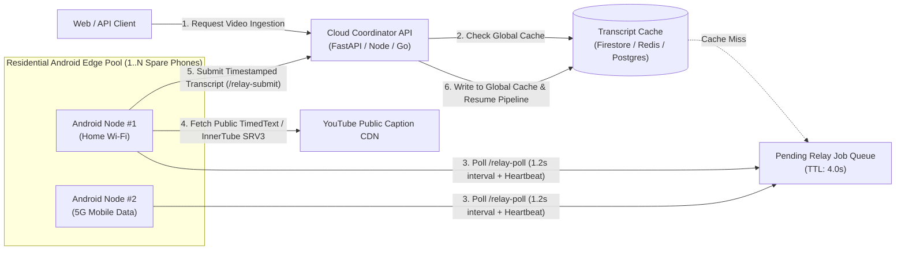

# YouTube Caption Edge Relay (`youtube-caption-edge-relay`)

[](#)
[](#)
[](#license)

A lightweight, fault-tolerant **Android Residential Edge Worker Node** built in Flutter for extracting public closed-caption (`CC`) and automatic speech recognition (`ASR`) subtitle tracks from YouTube videos on residential or mobile networks and relaying them to a coordinator backend in real time.

---

## 1. Problem Statement & Engineering Motivation

Modern cloud-hosted media indexing, accessibility compliance, and educational NLP pipelines run inside hyperscale datacenter ASN ranges (`AWS`, `Google Cloud Run`, `Azure`, `Hetzner`, `DigitalOcean`). When a cloud backend attempts to fetch public `timedtext` or InnerTube subtitle manifests directly from a datacenter IP:

1. **Datacenter ASN Rate-Limiting (`HTTP 429` / `Sign in to confirm you're not a bot`)**: Public video platforms aggressively throttle unauthenticated subtitle manifest fetches originating from cloud ASN blocks.
2. **Browser CORS Restrictions**: Client-side web apps (`Next.js`, `React`, `SPA`) cannot directly fetch third-party subtitle XML/SRV3 endpoints from a user's browser due to strict Cross-Origin Resource Sharing (`Access-Control-Allow-Origin`) policies.
3. **High Cost of Multimodal Video/Audio LLM Fallback**: Falling back to full video/audio transcription (`Whisper`, `Vertex AI Gemini Video`, ` Deepgram`) for a 60-minute lecture costs **$0.03–$0.30+ per video** and adds 20–60 seconds of latency—even when a public caption track already exists.

### The Residential Edge Relay Solution

By running **`youtube-caption-edge-relay`** on one or more spare Android devices connected to standard home Wi-Fi or 4G/5G mobile data:
- Subtitle extraction requests execute natively on a **genuine residential/mobile ASN** where public caption manifests resolve in **800ms–1,800ms** at **$0.00 API/compute cost**.
- Multiple Android phones can poll the same coordinator concurrently as a horizontally scalable worker pool.
- If all edge nodes are offline or unreachable past a configurable deadline (e.g., `4.0s`), the coordinator transparently falls back to its multimodal video/ASR pipeline with zero single point of failure.

---

## 2. System Architecture



### Dual-Path Subtitle Extraction Engine (`ResidentialCaptionExtractor`)
Each Android worker node implements a two-stage extraction pipeline:
1. **Primary InnerTube Manifest Resolution (`youtube_explode_dart`)**: Queries the Closed Caption manifest, prioritizes human-curated (`manual`) tracks over automatic (`ASR`) tracks, and ranks target languages (`hi` -> `en` -> fallback).
2. **Watch-Page `ytInitialPlayerResponse` Parser Fallback**: For recorded live streams (`isLiveContent: true`) where standard manifest endpoints omit ASR tracks, the node parses `playerCaptionsTracklistRenderer.captionTracks` directly from the mobile watch page HTML using a bounded brace-depth JSON scanner.
3. **Normalized Timestamp Formatting**: Emits compact, deterministic `[12.4s] text` lines capped at `1 MiB` to prevent memory pressure on low-end Android devices.

---

## 3. Broad Industry Use Cases for Developers

While originally engineered to power zero-cost lecture transcription for ed-tech platforms, this open-source edge worker is backend-agnostic and can be dropped into any media or NLP system:

1. **EdTech & Lecture Indexing**: Convert hours of university lectures, competitive exam coaching classes, and MOOCs into searchable study notes, flashcards, and quizzes without paying per-minute audio transcription fees.
2. **Digital Accessibility & Deaf/Hard-of-Hearing Archiving**: Audit public-interest broadcasts, government briefings, and educational channels for caption completeness and bilingual subtitle quality.
3. **Multilingual NLP & Low-Resource ASR Benchmarking**: Build aligned speech-to-text evaluation corpora across Indic (`hi`, `ta`, `te`, `bn`, `mr`) and global languages by comparing auto-generated captions against human transcripts.
4. **Media Monitoring & Fact-Checking Pipelines**: Index public news broadcasts and press conferences in near real-time (`< 2s` latency) so fact-checking agents can cross-verify spoken claims against live web sources.
5. **Podcast & Creator Search Engines**: Enable timestamp-accurate semantic search (`RAG` / vector embeddings) across thousands of creator videos without downloading gigabytes of `.mp4` streams in your cloud cluster.

---

## 4. Coordinator HTTP Protocol Specification

This app contains **zero hardcoded server URLs or credentials**. It communicates with any HTTP coordinator that implements two simple JSON endpoints:

### `POST /api/ingest/youtube/relay-poll`
Called every `1.2s` by each active Android node. Doubles as a live node heartbeat (`90s` liveness window).

**Request Headers:**
```http
Content-Type: application/json
x-relay-key: <optional-shared-secret>
```

**Request Body:**
```json
{
  "device_id": "android-edge-node-4821"
}
```

**Response (`200 OK`):**
```json
{
  "jobs": [
    { "videoId": "Py0qbsGJ9Kk" }
  ],
  "active_nodes": 2
}
```

---

### `POST /api/ingest/youtube/relay-submit`
Called immediately by the Android node once captions are extracted (or with an empty `transcript_text` if the video genuinely has no captions, allowing the coordinator to fail-fast before its timeout).

**Request Body:**
```json
{
  "device_id": "android-edge-node-4821",
  "video_id": "Py0qbsGJ9Kk",
  "transcript_text": "[0.0s] Welcome to today's session...\n[4.2s] Let us begin with...",
  "caption_kind": "auto",
  "video_title": "Lecture Title"
}
```

**Response (`200 OK`):**
```json
{
  "ok": true
}
```

---

## 5. Reference Coordinator Implementation (Python / FastAPI)

Below is a minimal, self-contained FastAPI coordinator snippet you can add to your own backend to work with this Android app:

```python
import asyncio, time
from fastapi import FastAPI, Header, HTTPException
from pydantic import BaseModel

app = FastAPI()
HEARTBEATS: dict[str, float] = {}
JOBS: dict[str, dict] = {}

class PollInput(BaseModel):
    device_id: str

class SubmitInput(BaseModel):
    device_id: str
    video_id: str
    transcript_text: str = ""
    caption_kind: str = "auto"
    video_title: str | None = None

@app.post("/api/ingest/youtube/relay-poll")
async def relay_poll(body: PollInput):
    now = time.time()
    HEARTBEATS[body.device_id] = now
    pending = [
        {"videoId": vid}
        for vid, job in JOBS.items()
        if job["status"] == "pending" and now - job["created_at"] < 30.0
    ][:5]
    active = sum(1 for ts in HEARTBEATS.values() if now - ts < 90.0)
    return {"jobs": pending, "active_nodes": active}

@app.post("/api/ingest/youtube/relay-submit")
async def relay_submit(body: SubmitInput):
    JOBS[body.video_id] = {
        "status": "completed" if body.transcript_text.strip() else "failed",
        "transcript_text": body.transcript_text.strip(),
        "caption_kind": body.caption_kind,
        "video_title": body.video_title,
        "completed_at": time.time(),
    }
    return {"ok": bool(body.transcript_text.strip())}
```

---

## 6. Building & Deploying on Spare Android Phones

### Prerequisites
- Flutter SDK `>= 3.7.0`
- Android SDK (`API 34+`)
- One or more Android phones (Android 8.0+ recommended)

### Build Release or Debug APK
```bash
git clone https://github.com/null-saurabh/youtube-caption-edge-relay.git
cd youtube-caption-edge-relay
flutter pub get
flutter build apk --release
```

### Install via ADB onto Connected Phone(s)
```bash
adb install -r build/app/outputs/flutter-apk/app-release.apk
```

### 24/7 Unattended Operation Checklist
1. Open **Caption Edge Relay** on the Android phone.
2. Enter your **Coordinator Base URL** (e.g. `https://your-api-service.run.app`) and optional **Relay Key**.
3. Tap **Test Fetch** on the built-in self-test card to verify residential subtitle extraction on your local Wi-Fi/5G connection.
4. Tap **Start Background Relay Worker**. Grant the Android **Foreground Notification** and **Ignore Battery Optimizations** prompts so Android's Doze mode never suspends the worker loop while the screen is off or the app is backgrounded.

---

## 7. Security & Privacy Design

- **Zero Hardcoded Endpoints or Keys**: All coordinator URLs, node identifiers, and optional shared secrets are entered at runtime via the UI and persisted locally on-device using `SharedPreferences`.
- **Unauthenticated Public Extraction**: The worker fetches only publicly available caption tracks without logging into any personal Google/YouTube account on the relay device.
- **Stateless Worker Memory**: Extracted transcripts are streamed directly to your coordinator and are never written to persistent storage on the phone.

---

## License

Released under the **MIT License**. Free for commercial and open-source use.
